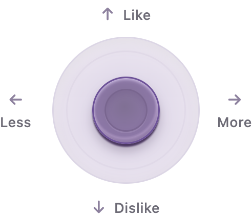
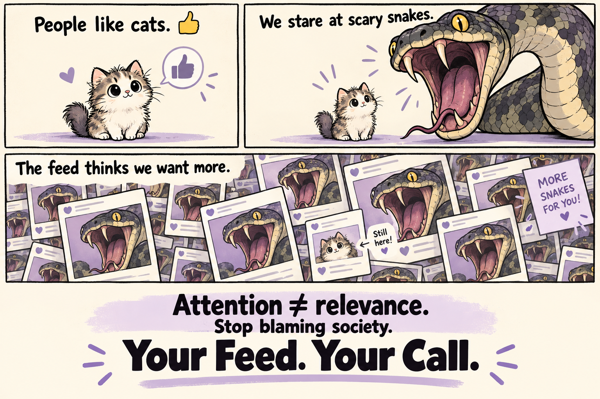
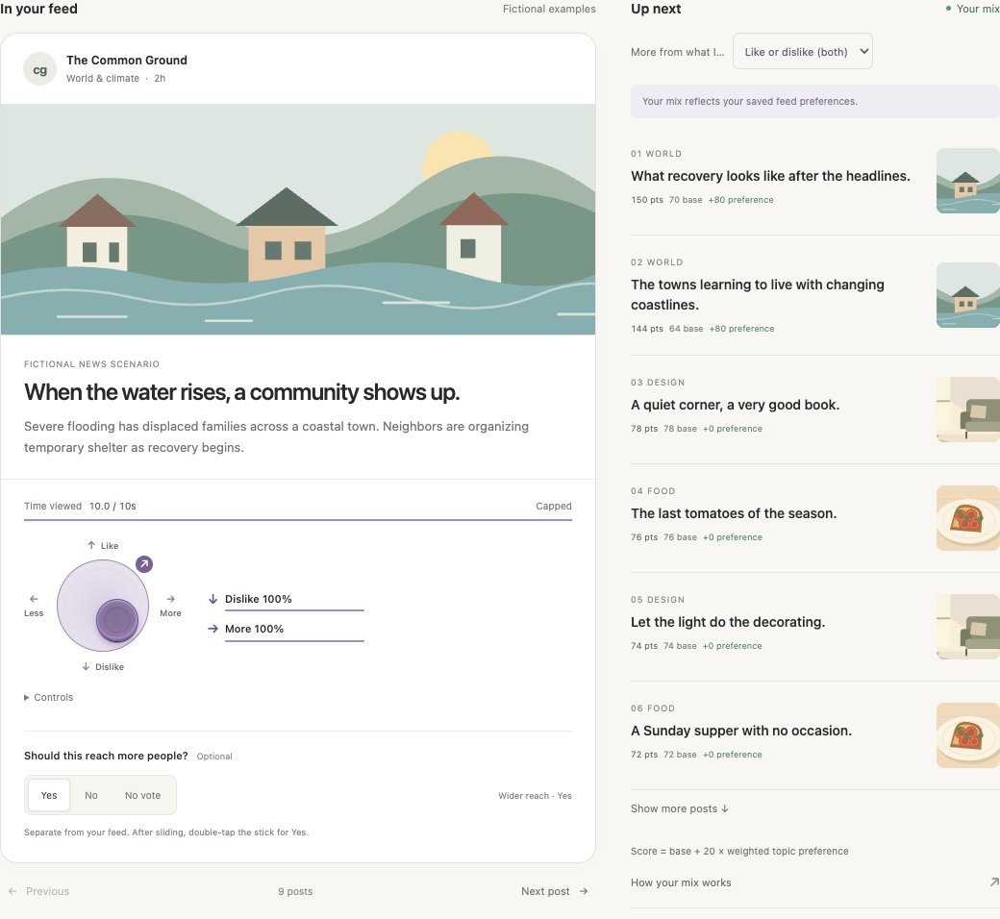

# Relevance



Relevance is an experimental proof of concept for a simple, intuitive relevance button in place of emoji reactions or likes.

We like cats 👍. We may stare even longer at a scary snake from a safe distance. A feed that treats a like or a long look as “show me more” can confuse our reactions with our wishes. Soon, we see more of something we never chose.



**Stop blaming society. Your Feed. Your Call.**

**What about real Relevance?**

A continuous thumbstick lets you say both **how you feel** and **whether you want more or less** of a post. Those answers are independent—but now both are at the same fingertip.



You can like something and want less of it, or dislike something and want more. A separate **Wider reach** opinion asks whether others might benefit from seeing it; it does not change your personal feed.

The working local demo uses a snapshot of more than 3,000 public Bluesky posts across 22 topics, plus nine fictional examples. It can fetch more public posts. Your choices stay in this browser's `localStorage` and rerank the local feed. Visible time can add weight to an explicit choice, capped at 10 seconds; it never creates a preference by itself. The default influence of a personal choice fades to zero over 14 days, and you can edit that duration. No account, API key, or build step is needed. This is a proof of concept, not a production-ready feed.

The next step is to keep developing this as a Bluesky proof of concept: use stored personal reactions and preferences to improve your own feed, and explore more expressive relevance and shareworthiness signals than engagement alone. An opt-in exchange of preference signals among people you follow could be explored, possibly using peer-to-peer storage such as IPFS; no sharing system or storage design has been chosen or implemented. These shared signals could fade over 14–30 days, keeping their influence temporary as people’s interests change. Fading influence does not delete shared data. Any future sharing would need explicit consent, visibility, and retention controls.

Let’s reshape social UX for good, together.

## Run

Requires Node.js 20 or later:

```sh
git clone https://github.com/ubiubi18/relevance.git
cd relevance
npm start
```

Open **http://localhost:4173/**. Stop with **Ctrl+C**. If the port is busy:

```sh
PORT=4174 npm start
```

The server listens on this computer only. The included JSON snapshot works without fetching again; images load from Bluesky's CDN and require internet access. Use browser device emulation for phone sizes.

## Try it

- Choose **Bluesky** or **Example posts**, then **All topics** or a specific topic.
- **Search loaded posts** filters post text, titles, and authors as you type. Multiple terms must all match, regardless of case. Search combines with the topic filter; **×** clears it. It searches the local collection and does not send your query or change your feed preferences.
- Slide down/right for **Dislike + More**, or up/left for **Like + Less**. The preview follows continuously, with gentle magnetic snapping near all four diagonal extremes (100% on both axes). Moving away releases the snap. Releasing saves, briefly pulses the stick, and immediately reranks **Up next**. **Undo** reverses the latest change.
- **Time viewed** accumulates visible time per post with millisecond precision, displayed in tenths of a second and capped at 10 seconds. At least half of its content (or half the viewport for a tall post) must remain visible while the page is visible and focused. Scrolling away, switching posts, hiding the tab, or losing focus pauses counting; returning resumes from the saved total. A short 125 ms glance counts as 0.125 seconds. Minutes or hours on the same post cannot exceed the cap. The seconds are an interest proxy, not proof of attention.
- **More from what I…** selects Like, Dislike, Both, or Neutral. It chooses which positive More responses count; Less always counts. Both includes all feelings, including neutral. The time cap (1–10 seconds), maximum weight (1–5×), and preference fade (1–365 days, default 14) are editable under **How your mix works**.
- **Next post** opens the highest-scoring unvisited post. **Show more posts** expands the ranked queue.
- **Explore topics** fetches global popular public feeds and current trending topics. Search feed names or use **More topics** to page through the public catalogue. Select a result to fetch its posts into the local snapshot and open that topic.
- **Fetch fresh posts** refreshes the selected topic, or all cached topics when **All topics** is selected. Existing personal feedback survives refreshes. A failed fetch keeps the previous snapshot.
- After saving a personal choice, **double-click or double-tap the thumbstick** to set **Wider reach: Yes**. It keeps both personal axes and their decay timestamp intact, shows a small ↗ marker, and supports Undo. Keyboard: focus the thumbstick and press Enter. An ordinary tap on the saved thumbstick leaves the personal answer unchanged.
- **Yes / No / No vote** records a separate opinion about wider reach; it never changes your personal feed or performs an action on Bluesky.

The thumbstick works with mouse, pen, and touch. Each axis stores a continuous value from −2 to +2; the center is neutral and diagonal gestures can reach both extremes. Keyboard: arrows adjust, Shift makes larger adjustments, releasing the last adjustment key saves, Home centers, and Escape cancels a movement in progress. Native sliders under **Controls** provide an alternative. Cancelled touches or focus loss do not save an unfinished gesture.

## Real post sources

`bluesky-cache.json` contains public post text, author attribution, original dates, image URLs and alt text, source feed membership, and links to the original posts. Text is displayed as plain text. Open **Bluesky ↗** for the current original and full context. The snapshot may include older posts; it is not a live mirror and does not automatically track later edits or deletions.

The local Node server reads the public AppView at `https://public.api.bsky.app` using `app.bsky.unspecced.getPopularFeedGenerators`, `app.bsky.unspecced.getTrendingTopics`, and `app.bsky.feed.getFeed`. No login or private feeds are used. Requests are bounded, spaced, and run at most two at a time. Imports deduplicate post IDs, exclude replies and actively labeled content, and may return partial results when a source is unavailable or the page cap is reached. The local catalogue keeps up to 6,000 posts, interleaving topics; refreshes replace the selected sources and preserve other cached topics.

**Global discovery is not an exhaustive index of every topic or post on Bluesky.** Topics here are public feed names and trending feed links, not semantic classifications. **Explore topics** searches feed names; **Search loaded posts** searches the text of the local snapshot. A post appearing in several feeds is counted once and assigned to one source topic. Upstream feeds have their own selection rules. The demo's own ranking does not use Bluesky likes or popularity counts. It uses explicit feedback and locally measured visible time as described below.

## Signals and storage

Browser `localStorage`, key `relevance.v1`, stores explicit `choices` and separate `views` by post ID (real posts use their AT URI). Optional `settings` store `dwellCap` (default 10), `maxWeight` (default 2), `feeling` (default `both`), and `decayDays` (default 14). Older saved choices remain compatible. For example, the choice portion is:

```json
{
  "version": 1,
  "choices": {
    "world-floods": {
      "reaction": -2,
      "feed": 2,
      "reach": null,
      "personal": true,
      "topic": "World",
      "updatedAt": 1790668800000
    }
  }
}
```

| Field | Meaning and use |
| --- | --- |
| `reaction` | −2 strongly dislike to +2 strongly like. The selected feeling mode decides whether a positive More answer counts. A dislike never silently becomes Less. |
| `feed` | −2 much less to +2 much more. Updates the preference for that source topic. |
| `reach` | `"yes"`, `"no"`, or `null`. A separate, local opinion about wider distribution. Never affects personal ranking. |
| `personal` | Whether personal feedback was explicitly confirmed. Reach-only votes do not silently add a neutral feed response. |
| `updatedAt` | Epoch milliseconds of the last explicitly confirmed personal answer. Confirming a new slider gesture renews its influence; the wider-reach shortcut does not. |
| `topic` | Stable source feed AT URI for real posts, or topic name for examples. Preserves the preference even if the original post leaves the snapshot. |

```text
weight = 1 + min(viewSeconds, timeCap) / timeCap × (maxWeight − 1)
freshness = max(0, 1 − ageInDays / decayDays)
signal = feed × weight × freshness
score = baseScore + 20 × mean(signal for the topic)
```

Every real Bluesky post starts at **70**. The following examples describe a freshly confirmed answer. With no recorded view time, a topic preference of +2 makes its score **110**; −2 makes it **30**. At the default 10-second cap, its weight is 2×: those scores become **150** and **−10**. Scores can be negative. Positive signals outside the selected feeling mode count as zero; negative signals always apply. A centered feed answer contributes zero, however long the post was viewed. Time-only and reach-only records do not enter the topic mean. New posts inherit topic scores; this demo does not predict their emotional content. Higher scores rank first, with ties preserving the original mixed order. Scores are points, not percentages. The visible rule and each recommendation's base/adjustment expose the calculation.

Preferences fade linearly toward neutral over **14 days** by default: 100% influence when saved, 50% after 7 days, and zero after 14 days. Both More and Less fade; raw reaction/feed values and independent reach votes remain saved. Each answer has its own timestamp. The topic mean keeps its original response count, so fading cannot be canceled out by renormalizing the weights. Changing the duration recalculates influence from the original timestamps; extending it can make older answers relevant again.

A new explicit slider movement, even back to the same position, renews that answer. Stationary taps on an already saved thumbstick are reserved for the double-tap reach shortcut and do not renew it. View-time updates, reach votes, settings changes, and page reloads never renew it. Undo restores the prior answer and its prior timestamp. Existing saved personal choices without dates start their fade on the first load of this version, and that migration is saved once. Scores are recalculated on interaction, on returning to the page, and once a minute while it is visible; no background service is needed while the site is closed.

A view record has the form `{ "seconds": 7.125, "topic": "World" }`. The accumulated visible time is stored up to the cap active during measurement, with a hard maximum of 10 seconds. Existing whole-second records become the starting total; older records/settings above 10 seconds are capped during loading. Lowering the cap limits scoring and display without deleting time already recorded within the 10-second maximum. Settings and view records stay in the browser.

Editing a response replaces its prior values. Neutral feed feedback counts as zero. Reading time alone records interest but never boosts recommendations: only an explicit More or Less answer gives it a ranking effect. Reaction, feed preference, and reach are never inferred from one another, clicks, reading time, or watch time. The app performs no posting, liking, sharing, reporting, moderation, or public vote aggregation. Feedback never leaves the browser; only public content requests go to Bluesky.

Choices are specific to this browser and origin (including its port). Unavailable browser storage falls back to memory with a warning. Undo and navigation history are session-only. Feedback/settings undo preserves independently measured view time. **Reset demo** clears choices, view records, and mix settings with undo; it leaves cached public posts intact.

## Files and checks

- `index.html`, `styles.css`, `app.mjs`: UI, interactions, discovery, and local choices.
- `core.mjs`: validated choices, view records, settings, and scoring.
- `dwell.mjs`: monotonic cumulative visible-time timer, with fractional seconds and a maximum 10-second cap.
- `bluesky.mjs`, `bluesky-cache.json`: public API importer and real snapshot.
- `data.mjs`: fictional examples and original SVG artwork.
- `server.mjs`: loopback server, discovery proxy, and atomic snapshot refresh.
- `tests/*.test.mjs`: focused ranking, persistence, importer, and input-validation tests.

```sh
npm test
```

Touch checks use browser emulation, not a physical-device or screen-reader certification.

The comic was created with OpenAI image generation; its [prompt is included](docs/comic-prompt.txt). The example screen is captured from the running prototype using fictional demo posts.
